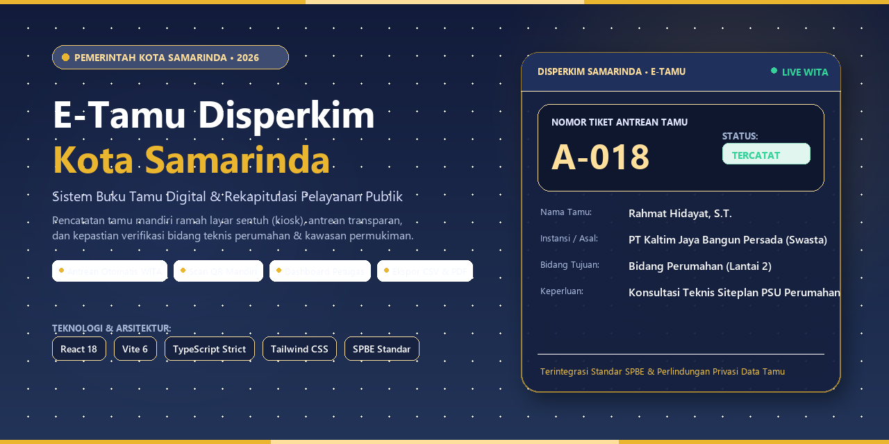

# E-Tamu Disperkim Kota Samarinda



> **Sistem Informasi Buku Tamu Digital & Rekapitulasi Pelayanan Publik**  
> Dinas Perumahan dan Kawasan Permukiman (Disperkim) Pemerintah Kota Samarinda.

Aplikasi web modern berbasis layar sentuh (*Kiosk Mode*) untuk pelayanan publik warga Kota Samarinda, terintegrasi dengan portal petugas piket serta dashboard rekapitulasi data dan pencetakan laporan resmi berstandar SPBE Kota Samarinda.

- 🌐 **Live Demo (GitHub Pages):** [https://lyntom.github.io/e-tamu](https://lyntom.github.io/e-tamu)
- 📦 **Repositori Sumber:** [https://github.com/lyntom/vibe-coding](https://github.com/lyntom/vibe-coding)
- 🚀 **Repositori Distribusi:** [https://github.com/lyntom/e-tamu](https://github.com/lyntom/e-tamu)

---

## 📌 Ringkasan Proyek

- **Fase Saat Ini:** Fase 1 (MVP - LocalStorage & Asynchronous Service Layer)
- **Framework & Runtime:** React 18+ dengan Vite 6 & TypeScript (`strict: true`)
- **Styling & Desain:** Tailwind CSS (*Civic Navy Slate* `#374774` & *Gold Accent* `#EAB630`)
- **Ikonografi:** `lucide-react`
- **Routing:** `react-router-dom` v6
- **Zona Waktu Resmi:** WITA (UTC+8)
- **Target Deployment:** Cloudflare Pages (disertai `public/_redirects`)

---

## 🚀 Fitur Utama Aplikasi

### 1. Mode Kiosk Publik Mandiri (`/`)
- **Jam & Tanggal Digital Real-Time (WITA):** Penunjuk waktu resmi pelayanan front office.
- **Helper Chips ("Bingung Menentukan Bidang Tujuan?"):** Tombol pintas cepat dengan notifikasi mengambang (*toast feedback*) yang otomatis memilih bidang dan menggulir lembut ke formulir.
- **Langkah 1 (Pilihan 4 Bidang Disperkim):** Kartu bidang responsif dilengkapi *badge* lantai, indikator ceklis emas, deskripsi layanan, dan panduan ruangan dinas (*division-tip*).
- **Langkah 2 (Formulir Identitas Tamu):**
  - *Segmented Control* 4 Kategori Tamu (Masyarakat Umum, Instansi/OPD, Pengembang/PT, Akademisi/Lain).
  - Kolom asal instansi / domisili dinamis dengan placeholder kontekstual Samarinda.
  - Validasi ketat format nomor WhatsApp/HP aktif.
  - Kolom maksud dan tujuan kunjungan.
- **Modal Tiket Kunjungan & Countdown 10 Detik:** Menampilkan nomor tiket antrean resmi (`TAMU-2026-XXX`) dan petunjuk arah ruangan. Dilengkapi hitung mundur 10 detik untuk mereset layar otomatis demi perlindungan privasi data tamu (kepatuhan UU PDP).
- **Modal QR Code Mandiri:** Memungkinkan pengunjung memindai QR code untuk mengisi formulir langsung dari ponsel pintar pribadi.
- **Sidebar Informasi:** Menampilkan Maklumat Pelayanan, Jam Layanan Front Office, serta total statistik tamu hari ini.

### 2. Portal Otentikasi Petugas (`/login`)
- **Akses Petugas ASN:** Gerbang masuk terotentikasi bagi petugas meja piket dan administrator.
- **Kredensial Pengujian MVP (One-Click Auto-Fill):**
  - **Username:** `admin`
  - **Password:** `disperkim2026`
  - Dilengkapi tombol interaktif **"Auto-fill"** untuk kemudahan pengujian.
- **Fitur Toggle Password:** Membuka/menutup visibilitas kata sandi.
- **Proteksi Rute (`ProtectedRoute`):** Mencegah akses ke dashboard admin tanpa sesi yang sah.

### 3. Dashboard Rekapitulasi & Manajemen Admin (`/admin`)
- **Bento 4 Metrik Statistik:**
  - Total Tamu Terfilter
  - Kunjungan Hari Ini
  - Kunjungan Bulan Berjalan
  - Bidang Terbanyak Dikunjungi (Persentase dan volume)
- **Panel Distribusi Bidang:** Grafik *progress bar* proporsi tamu antar bidang yang dihitung secara dinamis.
- **Toolbar Aksi Lengkap:**
  - `+ Input Tamu Manual`: Modal formulir pencatatan tamu langsung oleh petugas piket.
  - `Unduh CSV`: Mengekspor data terfilter ke format CSV ber-BOM UTF-8 (`\uFEFF`) dengan sanitasi pencegahan *CSV Formula Injection*.
  - `Cetak Rekap`: Pratinjau dan cetak kop surat resmi dinas lengkap dengan format tanda tangan petugas piket (`@media print`).
  - `Reset Sampel Data`: Mengembalikan data ke 18 data sampel realistis Kota Samarinda.
- **Pencarian & Filter Multi-Kriteria:** Filter pencarian teks bebas, dropdown bidang tujuan, dropdown kategori, preset periode waktu (Hari Ini, 7 Hari Terakhir, Bulan Berjalan, Semua Arsip), serta chip filter kilat.
- **Tabel Rekapitulasi Data Tamu:** Menampilkan nomor tiket, waktu, nama, kontak, instansi, bidang, dan maksud kunjungan, disertai aksi **Lihat Rincian**, **Edit**, dan **Hapus**.

---

## 🏛️ Matriks 4 Bidang Kerja Disperkim Kota Samarinda

| Kode Bidang | Nama Resmi Bidang | Lokasi Ruangan | Layanan Utama |
| :--- | :--- | :--- | :--- |
| `SEKRETARIAT` | **Sekretariat** | Lantai 1 - Sayap Kiri | Tata Usaha, surat dinas, kepegawaian, verifikasi SPJ, pengajuan PKL & Magang mahasiswa. |
| `PERUMAHAN` | **Bidang Perumahan** | Lantai 2 - Ruang 204 | Serah terima fasilitas umum/sosial (PSU) perumahan developer, verifikasi *site plan*, hunian formal. |
| `KAWASAN_PERMUKIMAN` | **Bidang Kawasan Permukiman** | Lantai 2 - Ruang 207 | Program Bantuan Stimulan Rumah Swadaya (BSPS / RTLH Bedah Rumah), penataan kawasan kumuh & tepian sungai. |
| `PSU` | **Bidang Prasarana, Sarana, dan Utilitas Umum (PSU)** | Lantai 1 - Sayap Kanan | Pelaporan kerusakan & pengajuan titik lampu penerangan jalan umum (LPJU), drainase gang, sarana bermain. |

---

## 🛠️ Arsitektur & Struktur Direktori

```text
vibe_coding/
├── public/
│   └── _redirects                      # Konfigurasi routing Cloudflare Pages (/* /index.html 200)
├── src/
│   ├── components/
│   │   ├── admin/                      # Komponen halaman Dashboard Admin
│   │   │   ├── AdminBentoStats.tsx
│   │   │   ├── AdminDetailModal.tsx
│   │   │   ├── AdminDivisionDistribution.tsx
│   │   │   ├── AdminFilters.tsx
│   │   │   ├── AdminGuestModal.tsx
│   │   │   ├── AdminGuestTable.tsx
│   │   │   ├── AdminHeader.tsx
│   │   │   ├── AdminPrintReport.tsx    # Kop surat resmi @media print
│   │   │   └── AdminToolbar.tsx
│   │   ├── common/
│   │   │   └── ProtectedRoute.tsx      # Guard rute autentikasi admin
│   │   └── kiosk/                      # Komponen antarmuka Mode Kiosk
│   │       ├── DivisionCards.tsx       # Langkah 1: Kartu 4 bidang
│   │       ├── GuestForm.tsx           # Langkah 2: Form identitas tamu & sidebar
│   │       ├── HelperChips.tsx         # Quick helper chips & floating toast
│   │       ├── KioskFooter.tsx         # Footer instansi Pemkot Samarinda
│   │       ├── KioskHeader.tsx         # Header paten Navy & aksen emas
│   │       ├── KioskHero.tsx           # Hero sambutan & jam real-time WITA
│   │       ├── QrModal.tsx             # Modal scan QR di ponsel
│   │       └── SuccessModal.tsx        # Modal tiket kunjungan & auto-reset 10s
│   ├── pages/
│   │   ├── AdminPage.tsx               # Rute /admin
│   │   ├── KioskPage.tsx               # Rute /
│   │   └── LoginPage.tsx               # Rute /login
│   ├── services/
│   │   ├── authService.ts              # Abstraksi autentikasi & sesi lokal
│   │   └── guestService.ts             # Service layer asinkron (Promise) & seed Samarinda
│   ├── types/
│   │   └── guest.ts                    # Kontrak data TypeScript & metadata bidang
│   ├── utils/
│   │   ├── date.ts                     # Helper waktu & tanggal format WITA
│   │   └── validation.ts               # Sanitasi & validasi input keamanan
│   ├── App.tsx                         # Router utama aplikasi
│   ├── index.css                       # Konfigurasi CSS Tailwind & @media print
│   └── main.tsx                        # Entry point React
├── index.html                          # Template HTML dengan Google Fonts
├── package.json                        # Definisi dependensi & skrip npm
├── tailwind.config.js                  # Token warna Navy Slate & Gold Accent
├── tsconfig.json                       # Konfigurasi TypeScript strict mode
└── vite.config.ts                      # Konfigurasi bundler Vite
```

---

## 💻 Panduan Menjalankan Aplikasi

### 1. Prasyarat Sistem
- **Node.js:** Versi 18.x atau lebih baru (direkomendasikan versi LTS).
- **Package Manager:** `npm` (atau `pnpm` / `yarn`).

### 2. Instalasi Dependensi
Jalankan perintah berikut di direktori proyek:
```bash
npm install
```

### 3. Menjalankan Server Pengembangan Lokal
```bash
npm run dev
```
Setelah server berjalan, buka peramban di:
- **Mode Kiosk Publik:** `http://localhost:5173/`
- **Portal Petugas:** `http://localhost:5173/login`
- **Dashboard Admin:** `http://localhost:5173/admin`

### 4. Pemeriksaan Tipe TypeScript
Untuk memverifikasi kebersihan kode tanpa galat tipe:
```bash
npx tsc --noEmit
```

### 5. Kompilasi Build Produksi
Untuk menghasilkan bundel produksi teroptimasi di direktori `dist/`:
```bash
npm run build
```

---

## 🔒 Kebijakan Keamanan & Privasi Data

1. **Privasi Pengunjung (UU PDP):** Layanan Kiosk publik menerapkan *auto-reset countdown* 10 detik pada tiket konfirmasi agar data pribadi (nama & nomor kontak) tidak tertinggal saat tamu berikutnya menggunakan terminal Kiosk.
2. **Pencegahan Injeksi CSV:** Seluruh sel teks yang diawali dengan karakter formula (`=`, `+`, `-`, `@`) secara otomatis diberi tanda kutip tunggal (`'`) sebelum diekspor ke berkas CSV.
3. **Pencegahan XSS:** Tidak ada penggunaan `dangerouslySetInnerHTML`. React secara otomatis melakukan *auto-escaping* terhadap seluruh masukan formulir.
4. **Isolasi Service Layer:** Komponen UI tidak melakukan manipulasi penyimpanan data langsung, melainkan melalui `guestService` berbasis *Promise* yang menjamin kesiapan migrasi ke backend Supabase pada Fase 2.

---

## 📄 Dokumen Spesifikasi Terkait

- [aturan_agen_ai_antigravity_opencode_desktop.md](aturan_agen_ai_antigravity_opencode_desktop.md) — Sumber kebenaran mutlak (*Single Source of Truth*) protokol kerja agen AI.
- [skema_data_kontrak_layanan.md](skema_data_kontrak_layanan.md) — Kontrak TypeScript, struktur entitas tamu, dan metadata bidang.
- [sistem_desain_spesifikasi_ui_ux.md](sistem_desain_spesifikasi_ui_ux.md) — Token warna identitas visual, tipografi, dan tata letak cetak kop surat.
- [kebijakan_keamanan_privasi_data.md](kebijakan_keamanan_privasi_data.md) — Standar validasi, sanitasi input, dan sesi autentikasi.
- [catatan_perubahan_proyek.md](catatan_perubahan_proyek.md) — Catatan riwayat versi dan perubahan fitur proyek.

---

## 🏛️ Hak Cipta & Lisensi

© 2026 Pemerintah Kota Samarinda.  
Dinas Perumahan dan Kawasan Permukiman Kota Samarinda.  
*Aman • Tertib • Terdata*
